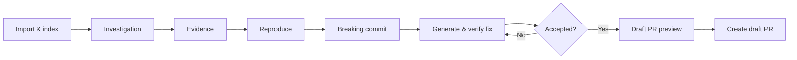
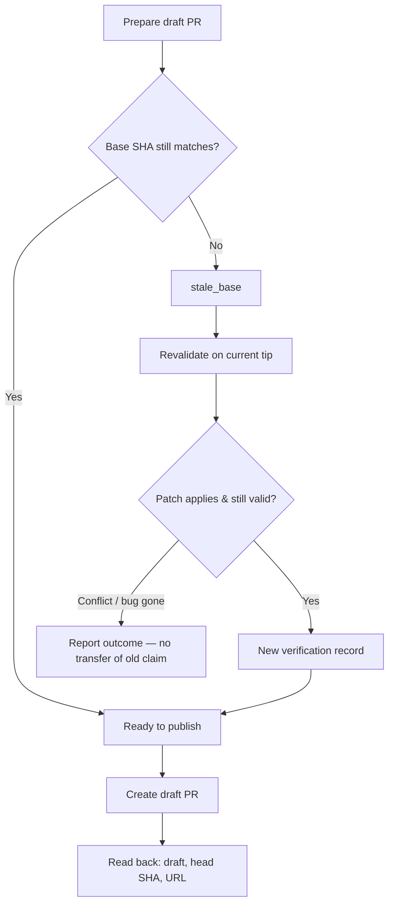
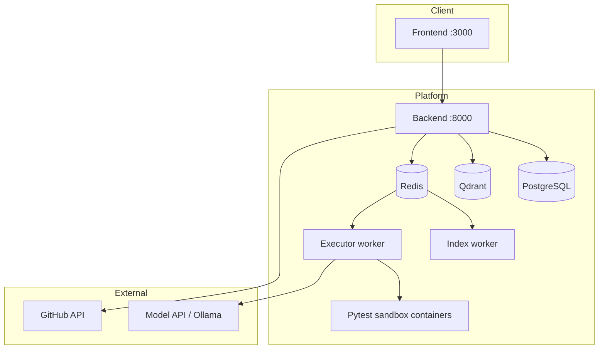
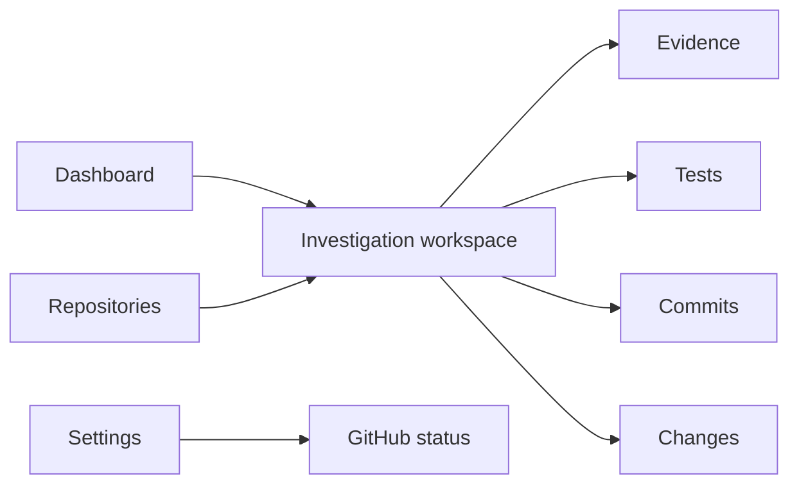

# BugTime AI

**Trace the bug. Find the breaking commit. Verify the fix. Open a draft PR.**

BugTime AI is an investigation workspace for real software failures. Instead of jumping straight to an AI-generated patch, it walks you through a trustworthy chain: find the relevant code, prove the bug with the project’s own tests, locate when it was introduced, verify a fix in a sandbox, and only then publish a draft pull request.

---

## What it does

When something is broken in a Python/pytest codebase, BugTime helps you answer four hard questions:

1. **Where should I look?** — Index a repository at a pinned commit and retrieve the most relevant files and symbols for the bug report.
2. **Can I reproduce it?** — Discover and run the repo’s existing tests in a disposable, locked-down container. Confirm the failure matches the bug you care about.
3. **When did it break?** — Search history with a frozen reproduction (same tests, same environment) and verify the introducing commit — not a guess from the commit message.
4. **Does this patch actually fix it?** — Propose a focused change with a model, re-run the reproduction and suite, review the exact patch by hash, then optionally open a **draft** GitHub PR with evidence and limitations spelled out.

Local BugTime results are always labeled as **BugTime verification**, not as GitHub CI.

---

## Who it’s for

Developers and teams who want AI assistance that stays grounded in:

- a **pinned** repository revision  
- **real** project tests  
- an **auditable** trail from evidence → reproduction → boundary → fix → draft PR  

It is not a generic “chat and hope” coding agent. Publishing stays blocked until the patch is verified and explicitly accepted.

---

## Product surface

| Area | Role |
| --- | --- |
| **Repositories** | Import a public GitHub repo (or load the built-in login-regression demo) and index it |
| **Investigations** | Capture the bug: title, description, expected vs actual behavior |
| **Evidence** | Ranked code snippets tied to the pinned commit |
| **Tests** | Discover pytest nodes, run reproduction, confirm the failure |
| **Commits** | Find and verify the breaking commit on linear history |
| **Changes** | Generate, validate, and accept/reject a verified patch; prepare a draft PR |
| **Settings** | Service health and GitHub connection status (token never shown in the UI) |

---

## How a case flows



Each stage leaves records you can revisit. A draft PR is allowed only when:

- the repair outcome is a **verified fix**  
- you accepted that **exact** patch hash  
- the destination repo matches the investigation  

If the target branch moved past the verified commit, BugTime marks the proposal stale and asks you to revalidate — it does not quietly reuse the old claim.



---

## Architecture (at a glance)

| Layer | Technology |
| --- | --- |
| UI | Next.js, React, TypeScript |
| API | FastAPI |
| Data | PostgreSQL + Qdrant (vectors) |
| Jobs | Redis + RQ (`worker` for indexing, `executor` for tests/repair) |
| Sandbox | Dedicated pytest image: no network, CPU/memory/time limits |
| Models | OpenAI-compatible API or local Ollama |
| Publishing | Server-side GitHub token → draft PRs only |



Sandbox containers never receive the Docker socket, app secrets, or the GitHub token.

### UI map



---

## Built-in demo

The repo includes a small **login regression** fixture (`demo-repo-v2`): mixed-case usernames stop authenticating after a bad change to username normalization. Use **Load demo repository** in the UI to try the full investigation loop without importing an external project.

After cloning this repository, restore the fixture’s git history once:

```bash
./scripts/restore-demo-fixture.sh
```

---

## Run locally

**Needs:** Docker Desktop (or Engine + Compose v2), ~4 GB RAM for the first embedding download.

```bash
git clone https://github.com/Sanjanabonagiri16/bugtime-ai.git
cd bugtime-ai
cp .env.example .env
./scripts/restore-demo-fixture.sh
docker build -t bugtime-pytest-runner:latest ./runner
docker compose up --build -d
```

- App: http://localhost:3000  
- API health: http://localhost:8000/api/v1/health  

Optional `.env` knobs (see `.env.example`):

- **`MODEL_*`** — cloud or Ollama for fix generation  
- **`GITHUB_TOKEN`** — fine-grained PAT (Contents + Pull requests) for draft PRs  
- **`RERANKER_MODE`** — evidence reranking; default is off  

---

## Optional capabilities

**Retrieval reranker (experimental).**  
BugTime can rerank evidence with a cross-encoder (`base` or a fine-tuned checkpoint). Fine-tuning / SWE-bench pilot work is **experimental** — useful for research notes, not a claim of production-grade generalization. Default installs leave the reranker disabled.

**Draft PR publishing.**  
From an accepted verified fix, prepare a preview (no remote side effects), edit title/body, then create a draft PR on an explicit action. Retries are idempotent; force-push and auto-merge are out of scope.

---

## What it deliberately does not do

- Invent reproduction tests instead of using the repo’s suite  
- Treat model similarity scores as root-cause certainty  
- Bisect merge-heavy histories in the current commit search  
- Push or merge for you — drafts only, after human accept  
- Put credentials in the browser, logs, clone URLs, or sandboxes  

---

## Project layout

```
backend/     API, workers, migrations, tests
frontend/    Investigation UI
runner/      Pytest sandbox image
demo-repo-v2/   Demo fixture (history via bundle + restore script)
docker-compose.yml
```

---

## License

Add your preferred license before a wider release if needed.
